
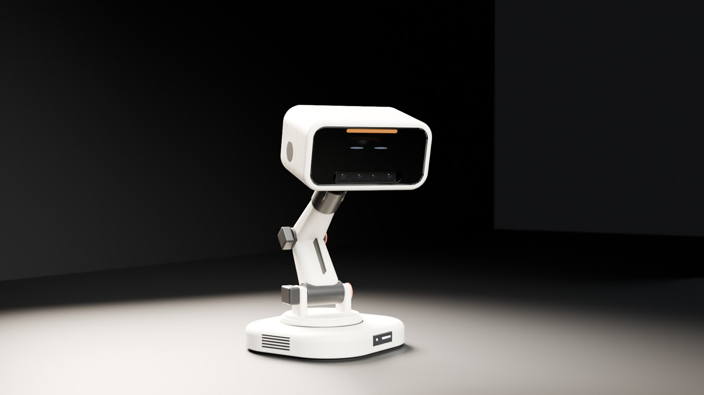

<h1 align="center">Project NOD</h1>

<b>A six-joint desk robot with a screen for a face, designed and built at home by one maker.</b>

<a href="https://graymattor.github.io/project-nod-showcase/"><b>Project page</b></a> &nbsp;·&nbsp;
<a href="https://www.youtube.com/@GraymattorWorks">YouTube</a> &nbsp;·&nbsp;
<a href="#where-it-stands">Status</a> &nbsp;·&nbsp;
<a href="#videos">Videos</a>

<code>6 joints</code> &nbsp; <code>5 head versions</code> &nbsp; <code>12 bench tests passed</code> &nbsp; <code>18 expressions on the real screen</code>

The head is designed and its electronics passed bench tests, board by board. Nothing is assembled yet. The spine is next.

---

## What NOD is

NOD is about 540 to 600 mm tall when awake. A base turns (J1), a spine bends (J2, J3), and a head turns, nods and tilts (J4, J5, J6). He has a touch-screen face, a depth camera, microphones, a speaker and a light bar that is meant to move with his voice.

The goal is a robot that reacts to the people around it with posture, light and a face, not a chat window on a stick.

> **NOD:** He spent months on my neck, then named me after it.

## Real hardware, not just renders

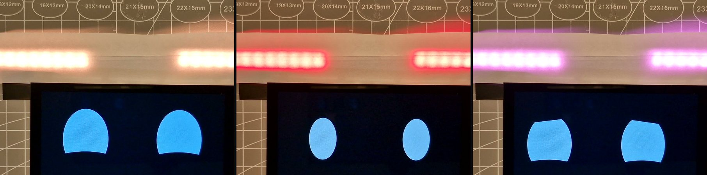

<b>Real footage.</b> Three of NOD's 18 expressions on the real screen, with the light bar colour-matched. Bench test program, not yet on the robot.

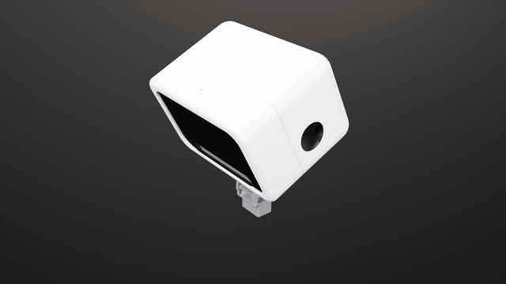 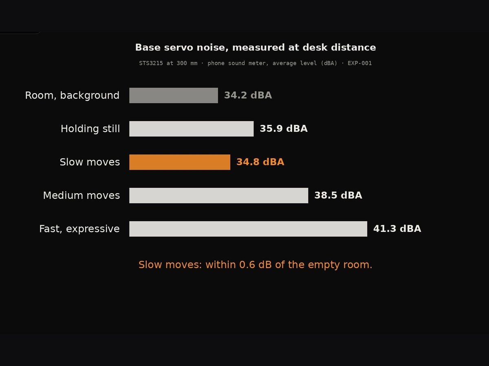

<b>Left:</b> the head, CAD animation (inside shown in plain grey, no part detail). <b>Right:</b> base servo noise, measured at desk distance.

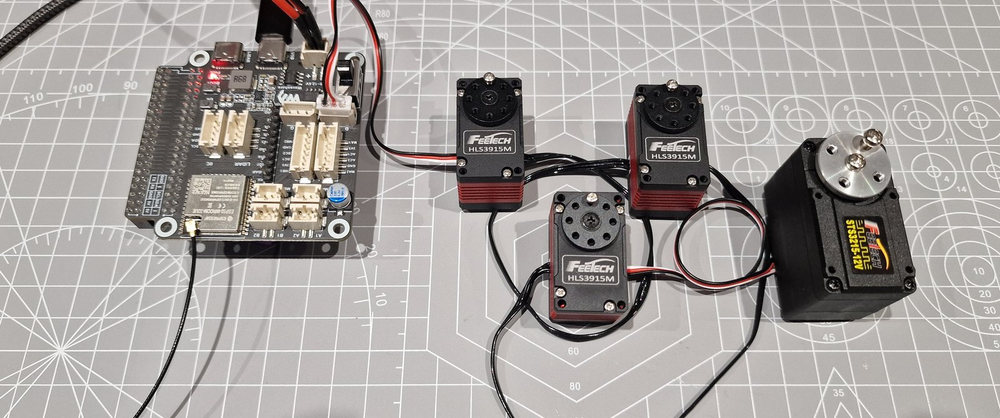

<b>Real photo.</b> First servo run, 9 Nov: all three head servos and the base servo on one cable. Unloaded bench test.

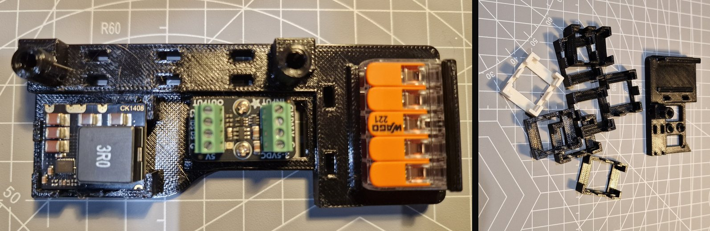

<b>Real photos.</b> The head power carrier with its boards fitted, and the fit prints it took to get there. Fitted, not yet wired.

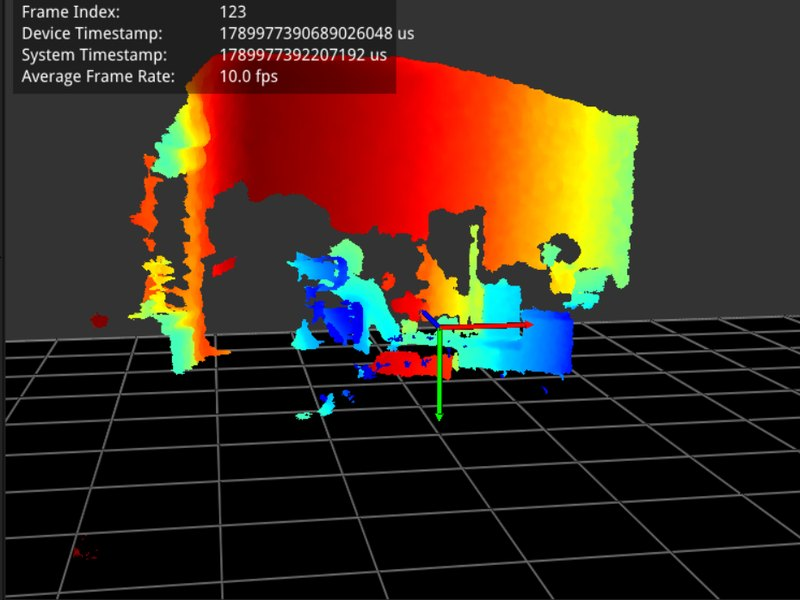 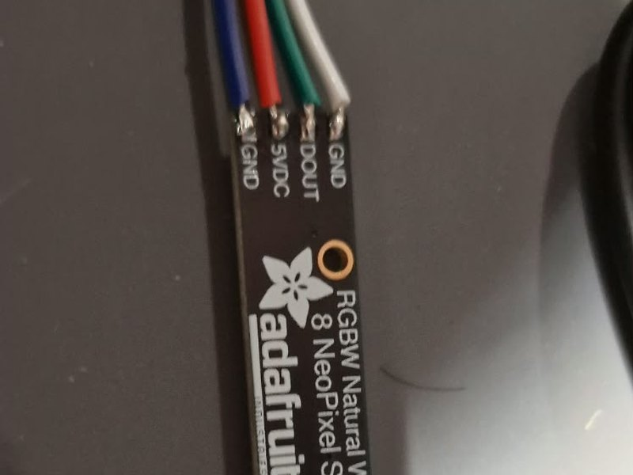 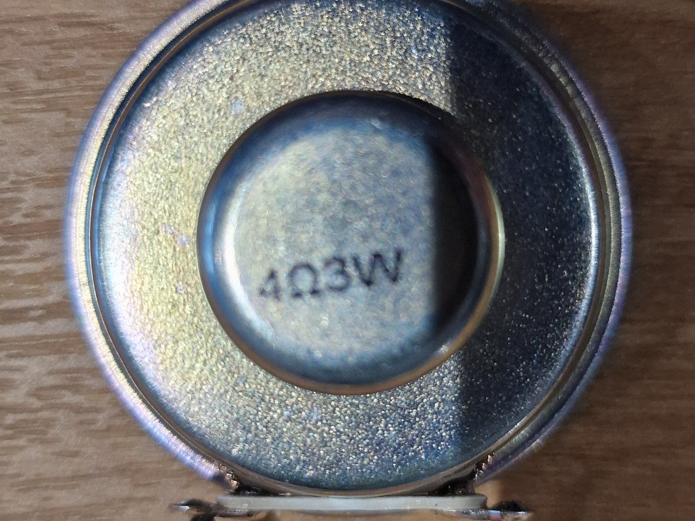

Bench tests: depth camera streaming on the Raspberry Pi 5 · light stick on the current rig · the head speaker.

## Where it stands

**● Built and tested**
- Each circuit board in the head passed a bench test on its own: the screen (recovery, animation and touch, 0.25 A max), the light bar (0.63 A at 4.84 V, all 16 pixels on), the depth camera (stream, reconnect, Raspberry Pi 5), the USB hub (four-device recovery) and the microphones (standalone bring-up).
- The bearing-pocket fit is proven on a printed PETG test coupon.
- NOD's 18 expressions run on the real screen, with the light bar colour-matched (bench test programs).
- Base servo noise at 300 mm: slow moves at 34.8 dBA, against a quiet room at 34.2.
- All three head servos have run on the bench, daisy-chained with the base servo on one cable.
- These are electronics and print tests, not a working head. Nothing is assembled yet.

**◐ Designed in CAD**
- The head is finished in Fusion 360, and fit prints are underway. Its joints are subassemblies (J4 cassette, J5 cradle, J6 bearing cartridges). Screws hold the shell on.
- Head mass is 1.0 to 1.3 kg, estimated from CAD and not yet weighed.

**○ Planned**
- The spine (J2/J3), the base (J1) and power.
- Motion, face and voice running live on the robot, from its own controller.

## Test log

Every physical test so far. Simulations, reviews and datasheet research are not counted.

- **10 Sep** · Controller candidate bring-up: passed, then rejected because its pins were awkward to wire.
- **14 Sep** · Base servo on the bench: passed. Repeated moves at three speeds, about 38 °C, noise measured.
- **21 Sep** · Depth camera on the Raspberry Pi 5: passed. A slow link was traced to a mislabelled cable.
- **21 Sep** · Microphone board: passed. Capture, playback and recovery.
- **21 Sep** · Three head devices on one USB hub: passed. 20 reconnects, 11 power cycles, zero faults.
- **24 Sep** · Printed bearing pocket: passed. The pocket size for every head joint comes from this print.
- **24 Sep** · Screen mounting coupon: passed. Five hole sizes printed, service fit chosen.
- **5 Oct** · Depth camera endurance on Windows and the Pi 5: passed.
- **5 Oct** · Four devices on one hub, with the ESP32-S3 controller, camera streaming from the Pi 5: passed. About 1.2 to 1.3 A in total (recalled, not logged); a separate hub supply made no difference.
- **10 Oct** · Touch screen: passed. 0.25 A max, worst refresh about 26 ms.
- **10 Oct** · Light bar: passed. 0.63 A full on, 0.11 A at half white.
- **5 Nov** · NOD's face on the real screen: partly done. Eyes and light-bar colour confirmed.
- **9 Nov** · First head servo run: passed. All three head servos and the base servo daisy-chained on one cable, every reading returned, exact moves. Filmed.

Still to test: head servo noise, hearing while the head moves, base torque limit, radar from the base, neck fork twist, voice on the Pi 5.

## How he will be controlled

NOD is meant to act on his own, inside limits that are written down and proven. The control software is being written for NOD in four layers:

- **Safety controller:** its own board and firmware. It checks every move against NOD's limits and watches load, heat and the link to the brain. Nothing overrides it.
- **Motion:** smooth moves between poses, planned inside the limits.
- **Behaviour:** what NOD wants to do. AI helps choose words and intent, but never sends a motor angle.
- **Senses:** camera, microphones, radar and touch.

The limits are kept as a control plan: each one has a characteristic, a method and a reaction, and each is proven on the bench rig before the firmware enforces it.

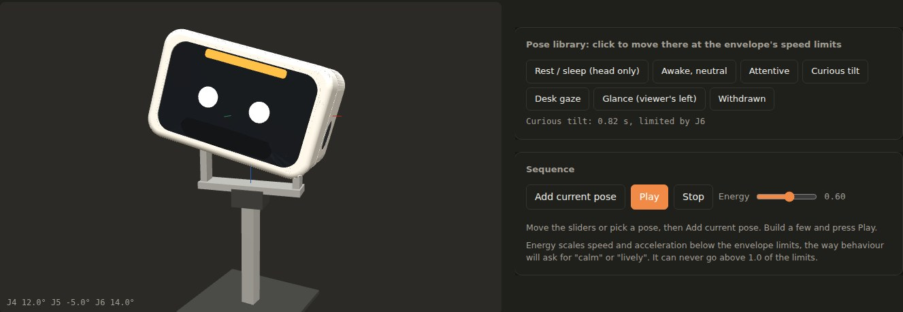

<b>NOD Control Studio</b>, our own planning tool. The real shell, outside parts only. Not yet connected to the robot.

## Roadmap

Hardware and software move side by side, and every stage ends in a test.

1. ✅ Electronics tested, board by board
2. ✅ Head designed
3. ▶️ **Head bench rig:** the whole head running on a post, its limits proven, and the real head weighed
4. Software on the rig: safety firmware, face, voice, then senses and first behaviours
5. Spine J2/J3: lift, hold and fail safely
6. Base J1: swivel, power and sensors
7. Integration: everything powered at once, an hour with no resets
8. First motion: face, light and posture together
9. Soak and finish: days of running for wear, then the final shell

Planned now, not left to the end: clean shutdown when the power is cut, head and spine that settle rather than slump, calibration after any servo swap, soak tests for wear and heat, a written privacy rule for the camera and microphones, and a compliance route if kits are ever sold.

## Videos

<a href="https://www.youtube.com/watch?v=KsJcDA6TDW4">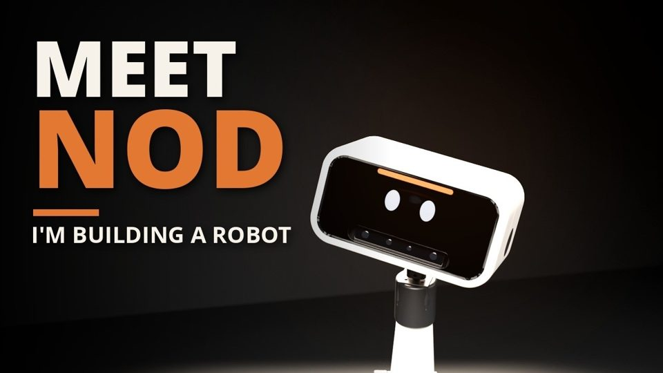</a> <b>Meet NOD: Building a Real AI Robot From Scratch</b> · intro, 84 s

<a href="https://www.youtube.com/watch?v=Y7uVlZmpFEw">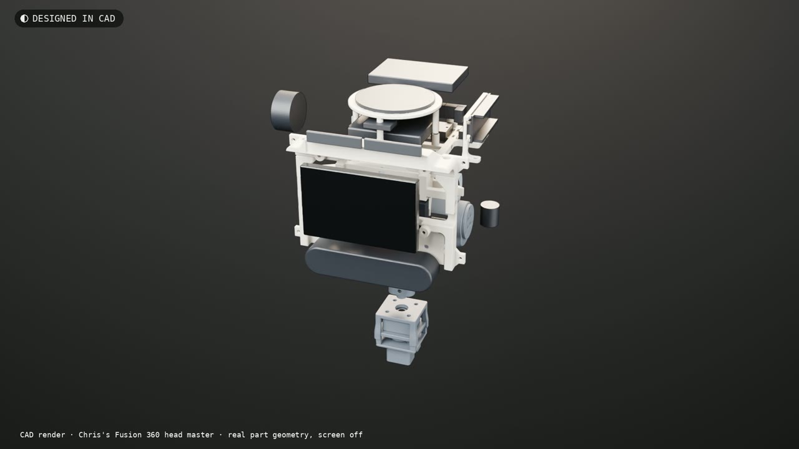</a> <b>My Cartoon Robot Is Real: Inside Project NOD's Head</b> · the engineering, 2 min 17 s

<a href="https://youtube.com/shorts/ErAWYZsyNeg">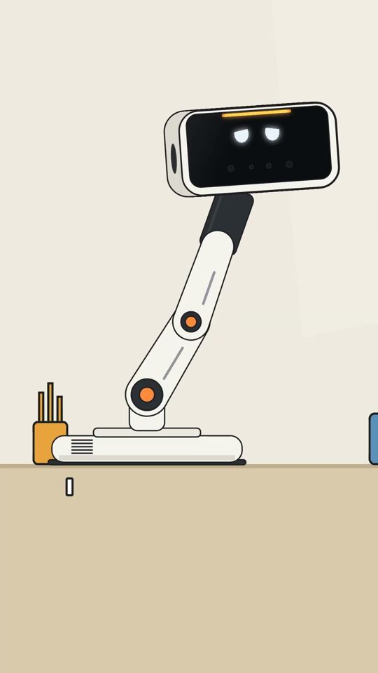</a>
<a href="https://youtube.com/shorts/nzT1gDBxtX4">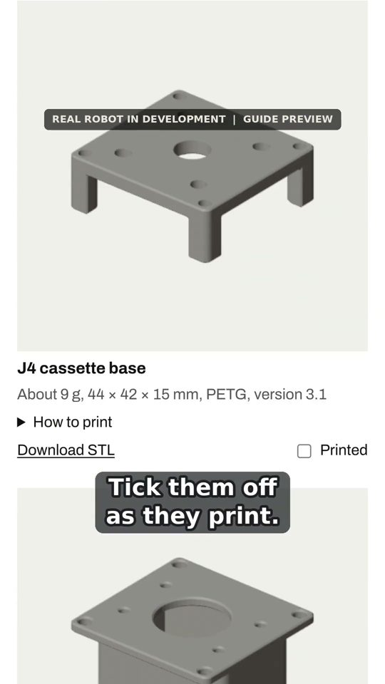</a>
<a href="https://youtube.com/shorts/yeVYFU0_D28">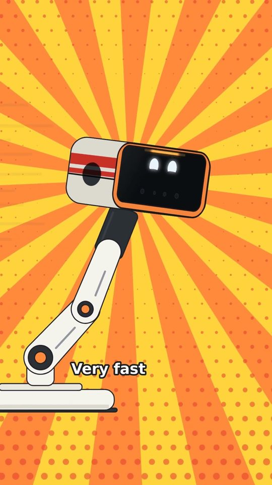</a>
<a href="https://youtube.com/shorts/-Q6wMnWl26s">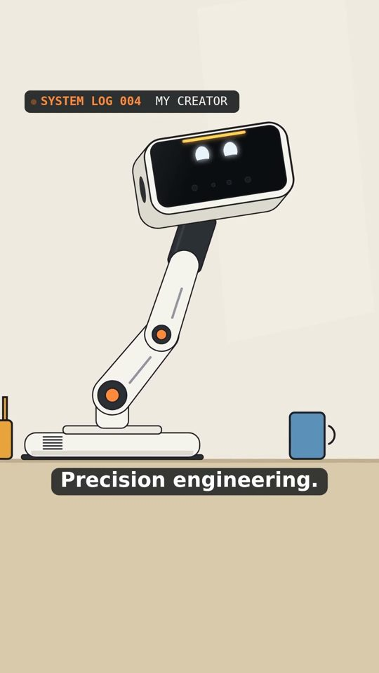</a>

Shorts: I'm Actually Being Built?! · The 3D Assembly Guide · My Robot Is Jealous! · Why He Is Called NOD

## The other NOD

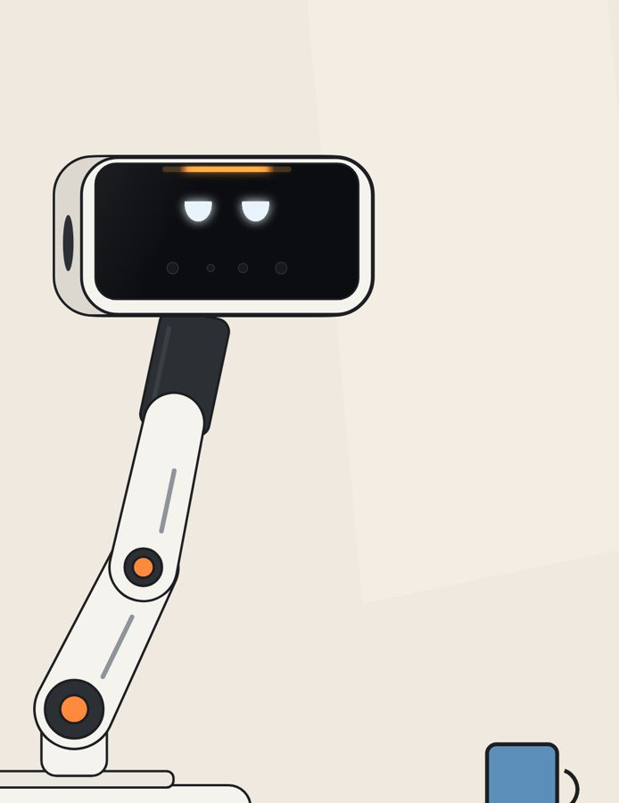

NOD has a cartoon twin on the [Graymattor Works](https://www.youtube.com/@GraymattorWorks) channel. The twin has the same head, the same joints, and the same face and voice files as the real robot. He is dry, sarcastic and occasionally right, and he presents his own build.

Every stage of the real build is filmed, mistakes included.

 

## About this repository

This repository holds the public project page only. NOD's CAD, firmware, electronics design and development documents are private and are not published here. Renders are labelled as renders.

© Graymattor Works. All rights reserved. Not sponsored. Just hopeful.
